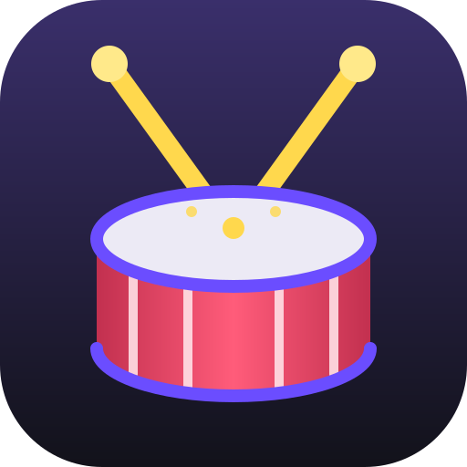

#  鍵盤打鼓 Keyboard Drum

用電腦鍵盤打鼓的網頁遊戲，直接用瀏覽器打開 `index.html` 即可遊玩。

## 按鍵

| 鍵 | A | S | D | F | J | K | L | ; |
|---|---|---|---|---|---|---|---|---|
| 鼓 | 大鼓 | 小鼓 | 閉合鈸 | 開放鈸 | 高音鼓 | 中音鼓 | 落地鼓 | 碎音鈸 |

## 模式

- **自由演奏**：隨意敲擊，所有鼓聲都以 Web Audio 即時合成。
- **節奏挑戰**：8 首歌（含迪斯可、嘻哈、拉丁森巴、鼓打貝斯等動感節奏，附貝斯伴奏），選歌與速度（40%～125%）後按空白鍵開始，音符落到白線時按下對應按鍵。判定分為完美／不錯／失誤，有連擊加分、準確率與 S～D 評級，並保存每首歌的最高分。

空白鍵：開始／重來　Esc：停止　↑／↓ 或 🔊 滑桿：調整音量。手機可直接點擊鼓墊。

### ⏸ 等我按（練習模式）

開啟後音符會停在白線上，等你按對鍵才繼續，對應的鼓墊會發光提示。適合慢慢練新節奏。

| 鍵 | 功能 |
|---|---|
| 空白鍵 | 開始／重來 |
| Esc | 停止 |
| ↑ / ↓ | 音量 |
| W | 切換等我按 |
| B | 切換貝斯伴奏 |
